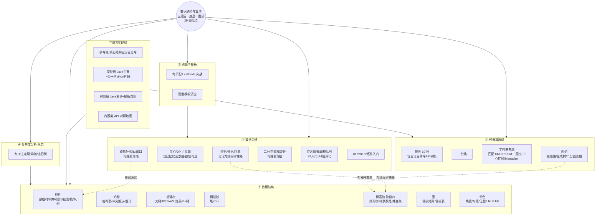

## 二、修订后的清单（v2）

**修订原则**：不推翻 29 点框架，只做“归属修正 + 顺序标注 + 内容补齐”。

### 阶段一：基础层（5 点）

|编号|细化点|核心内容|级别|代表题|
|---|---|---|---|---|
|**B1**|复杂度分析|大O、常见阶、递归树、主定理、均摊分析（扩容）、面试话术|纵贯（无语言实现）|复杂度判断|
|**B2**|数组、字符串与矩阵|三语言底层差异、动态数组扩容、**矩阵专题**（旋转图像/螺旋/搜索二维矩阵）|手写|移除元素、买卖股票I、有序数组去重、旋转图像|
|**B3**|链表|单/双/循环手写三语言、Floyd判圈|手写|反转链表族、合并有序、环检测、K个一组|
|**B4**|栈与队列|手写栈/循环队列、双端队列、单调栈/队列**入门**（思想深化在 A4 后回补）|手写|有效括号、最小栈、接雨水、滑动窗口最大值|
|**B5**|哈希表|冲突解决三语言差异（链地址 vs 开放寻址）、手写HashMap、负载因子扩容|手写|两数之和、字母异位词分组、最长连续序列|

### 阶段二：树层（5 点，T5 后移）

|编号|细化点|核心内容|级别|代表题|
|---|---|---|---|---|
|**T1**|二叉树|四种遍历（递归+迭代双解三语言）、层序、深度/对称/翻转/LCA|手写|层序遍历、最大深度、最近公共祖先|
|**T2**|BST、平衡树与 B+ 树|BST增删查（删除三情况）、验证BST、AVL四种旋转推导、红黑树五性质、**B/B+树原理（打通MySQL索引）**|深挖|验证BST、BST第K小、有序数组转BST|
|**T3**|堆与优先队列|二叉堆手写、建堆O(n)、**三语言默认方向差异**、TopK族、双堆|手写|数组第K大、前K个高频、数据流中位数|
|**T4**|Trie 前缀树|手写三语言、应用场景|手写|实现Trie、单词替换、添加与搜索单词|
|~~T5~~|_线段树与树状数组_|_移至阶段四（依赖 A1 分治）_|—|—|
|~~T6~~|_并查集_|_移至阶段四（衔接 Kruskal/岛屿）_|—|—|

### 阶段三：算法思想（11 点，A1 提前到 T1 后穿插）

|编号|细化点|核心内容|级别|代表题|
|---|---|---|---|---|
|**A1**|递归与分治|递归三要素、递归树、分治模板（**为 T5 线段树铺路**）|对照|Pow(x,n)|
|**A2**|回溯|回溯模板、组合/排列/子集三大族、剪枝|对照|全排列、N皇后|
|**A3**|贪心|局部最优推全局、区间问题族|对照|跳跃游戏、无重叠区间、合并区间|
|**A4**|双指针与滑动窗口|对撞/快慢/同向、窗口模板（依赖 B2/B3，**可提前穿插**）|对照|三数之和、无重复最长子串、最小覆盖子串|
|**A5**|二分查找|标准/左右边界/旋转/二分答案、**mid溢出三语言差异**（可提前穿插）|对照|搜索旋转数组、x的平方根|
|**A6**|前缀和与差分|一维/二维、差分（可提前穿插）|对照|和为K的子数组、航班预订统计|
|**A7**|DFS/BFS 框架|通用双框架（拓扑**入门**，深化在 G 系列）|对照|岛屿数量、课程表I|
|**A8**|DP 入门与线性 DP|重叠子问题/最优子结构、**递归→记忆化→递推三部曲**、打家劫舍族|对照|打家劫舍、最大子数组和|
|**A9**|双序列与背包|LCS、编辑距离、01/完全/多重背包|对照|最长公共子序列、编辑距离|
|**A10**|进阶 DP|区间/树形/状压、LIS O(nlogn)、**数位DP（可选扩展）**|对照|戳气球、监控二叉树|
|**A11**|位运算|异或性质、常用技巧|对照|只出现一次的数字、位1的个数|

### 阶段四：图、高级结构与经典（6 点）

|编号|细化点|核心内容|级别|代表题|
|---|---|---|---|---|
|**G1**|图结构与遍历|邻接矩阵/邻接表手写、图上DFS/BFS、岛屿族|手写|岛屿数量、克隆图、腐烂的橘子、单词接龙|
|**G2**|图论经典算法|Dijkstra（手写+堆优化）、Bellman-Ford、Floyd、Kruskal、Prim、**二分图染色**|深挖|网络延迟时间、判断二分图|
|**S1**|排序专题|10 种手写三语言、复杂度稳定性表、快速选择、**三语言排序API与自定义比较器对照**|手写|颜色分类、数组第K大、最大数|
|**S2**|字符串专题（匹配+回文）|KMP（next推导到底）、RK哈希、BM概念、**回文：中心扩展法 + Manacher**|深挖|实现strStr、最长回文子串、分割回文串II|
|**T5**|线段树与树状数组|手写（建树/更新/查询/懒标记概念）、lowbit（此时已有分治底子）|深挖|区域和检索-可修改、反转对|
|**T6**|并查集|手写（路径压缩+按秩合并三语言）、连通性应用|手写|省份数量、冗余连接、账户合并|

### 阶段五：特色与收口（3 点）

| 编号     | 细化点       | 核心内容                           | 级别  | 代表题                         |
| ------ | --------- | ------------------------------ | --- | --------------------------- |
| **X1** | 手撕设计专题    | LRU、LFU、最小栈、**O(1)随机集合、水塘抽样**  | 手写  | LRU缓存、LFU缓存、常数时间插入删除、链表随机节点 |
| **X2** | 高级结构      | 跳表手写（打通Redis ZSet）、布隆过滤器、位图    | 深挖  | 设计跳表、最长的超赞字符串               |

> **模块边界**：具体语言的集合实现 → 各语言模块（Java 集合等）；数据库索引结构 → MySQL 模块；网络路由算法 → 计算机基础模块。本模块提供数据结构与算法的通用体系。

**① 复杂度分析**

1. 时间复杂度（大 O、最坏 / 平均）
2. 空间复杂度
3. 常见复杂度对比
4. 均摊分析（动态数组扩容的例子）
5. 复杂度与数据规模的对应（反推可用算法）

**② 线性表** 6. 数组（连续存储与随机访问） 7. 链表（单 / 双 / 循环） 8. 栈与经典应用（括号匹配 / 表达式求值） 9. 队列、双端队列、优先队列与应用（BFS / 滑动窗口最大值） 10. 跳表

**③ 高频套路** 11. 双指针 12. 滑动窗口 13. 前缀和与差分 14. 单调栈 15. 单调队列

**④ 哈希** 16. 哈希表 17. 哈希函数 18. 冲突解决（链地址 / 开放寻址） 19. 负载因子与扩容 20. 一致性哈希

**⑤ 树** 21. 二叉树与遍历（前中后序 + 层序，含迭代写法） 22. 二叉搜索树（增删查 / 退化风险） 23. 平衡树（红黑树性质 / AVL 旋转） 24. 堆（大顶 / 小顶 / 建堆 / 堆调整） 25. Trie（字典树） 26. 并查集（路径压缩 + 按秩合并） 27. B 树 / B+ 树、在 MySQL 的落点 28. 线段树 / 树状数组

**⑥ 图** 29. 图的表示（邻接矩阵 vs 邻接表） 30. 遍历（DFS / BFS、递归与迭代互转） 31. 最短路径（Dijkstra 与负权限制 / Bellman-Ford / Floyd） 32. 最小生成树（Prim / Kruskal） 33. 拓扑排序、应用（依赖解析） 34. 强连通分量 35. 二分图

**⑦ 排序** 36. 基础排序（冒泡 / 选择 / 插入） 37. 希尔排序 38. 归并排序 39. 快速排序（分区 / 优化） 40. 堆排序 41. 线性排序（计数 / 桶 / 基数） 42. 排序算法对比表、三语言排序 API 对照

**⑧ 查找** 43. 二分查找（边界问题） 44. 二分答案

**⑨ 算法思想** 45. 分治 46. 贪心、与 DP 的区分 47. 动态规划（线性 / 区间 / 背包 / 树形 / 状态压缩）、空间优化 48. 回溯（模板化：排列 / 组合 / 子集 / 棋盘） 49. 减治

**⑩ 字符串** 50. 字符串匹配（KMP 与 next / BM / Rabin-Karp） 51. 回文（Manacher） 52. 编辑距离、三语言字符串 API 对照

**⑪ 数学与位运算** 53. 位运算 54. 快速幂 55. 质数筛

**⑫ 工程落点、实战与坑** 56. 红黑树 / B+ 树在工程中的落点（HashMap / MySQL） 57. 高频题型与解题模板 58. 常见坑清单（二分边界 / 整数溢出 / DP 初始化 / 递归栈溢出 / 哈希退化） 59. 刷题路线与优先级（数据结构 → 算法思想 → 高频题） 60. 与前面模块的呼应索引（哈希↔HashMap、树↔MySQL 索引、图↔网络路由、DP↔字符串相似度）